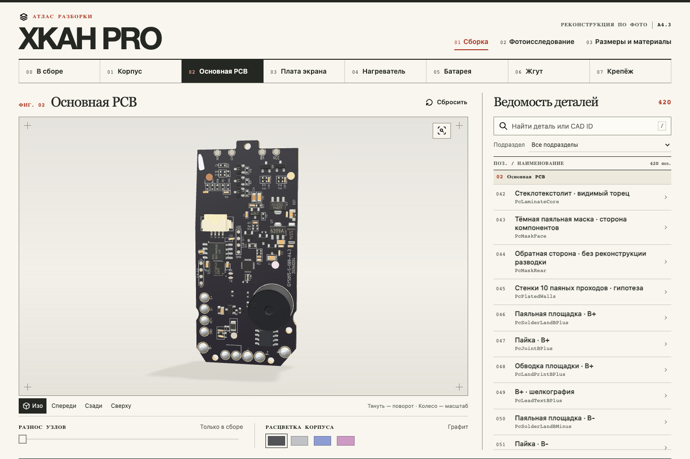

# XKAH PRO · Teardown Atlas

   

Spin the assembled XKAH PRO, pull its seven assemblies apart, then pick a single solder joint or the diamond texture on a key. The offline atlas and the editable FreeCAD model share the same geometry and part IDs.

**[Open the atlas](atlas/index.html)** in the unpacked release. Switch between Graphite, Silver, Blue and Pink, or jump straight to the A4.3 mainboard, display and fourteen-wire harness. Each part links back to its reconstruction evidence.

The release includes the editable FreeCAD assembly, full and split STEP models, and nine A3 drawing sheets. [Read the engineering notes](docs/engineering.ru.md).

Original viewer and CAD tools: [MIT](LICENSE). [Three.js](atlas/vendor/three-LICENSE.txt), [noUiSlider and Tabler Icons](atlas/vendor/ui-LICENSES.md) ship with their licenses. XKAH and XYKA are product identifiers; reference photographs retain their original rights.
