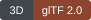
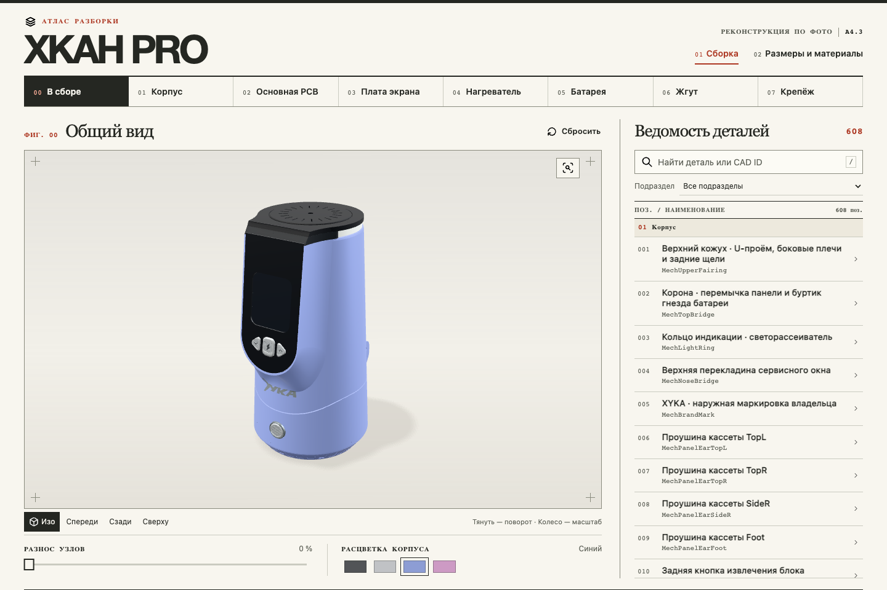

# Inside XYKA PRO · Teardown Atlas

   

Choose Graphite, Silver, Blue or Pink. Then lift out the battery, separate the two halves and open the steel pod to reveal its mesh. This independent reconstruction of the XKAH / XYKA PRO puts **660 selectable parts** and **13 teardown stages** in your browser.

**[Launch the 3D atlas](https://georgy-hook.github.io/xyka-pro-atlas/)** · [Download the offline studio](https://github.com/Georgy-hook/xyka-pro-atlas/releases/latest/download/XYKA_PRO_A43_Studio.zip)

Explore online, or unzip the studio and open `atlas/index.html` to take it offline.

Select a component in 3D to see its name, dimensions and source. Take the same assembly into FreeCAD, use the full and split STEP models in your CAD tool, or follow the visible copper on the [mainboard](pcb/main/GYS005-S-088-A4.3.kicad_pcb) and [display board](pcb/display/20260305A.kicad_pcb) in KiCad.

[FreeCAD assembly](https://github.com/Georgy-hook/xyka-pro-atlas/releases/latest/download/XKAH_PRO_A43_rebuilt.FCStd) · [31-sheet drawing set (PDF)](https://github.com/Georgy-hook/xyka-pro-atlas/releases/latest/download/XKAH_PRO_A43_drawings.pdf) · [Engineering notes and sources](docs/engineering.ru.md)

Original viewer and CAD tools: [MIT](LICENSE). Third-party notices: [Three.js](atlas/vendor/three-LICENSE.txt), [noUiSlider and Tabler Icons](atlas/vendor/ui-LICENSES.md), [osifont](docs/licenses/osifont.txt). XKAH and XYKA are product identifiers.
