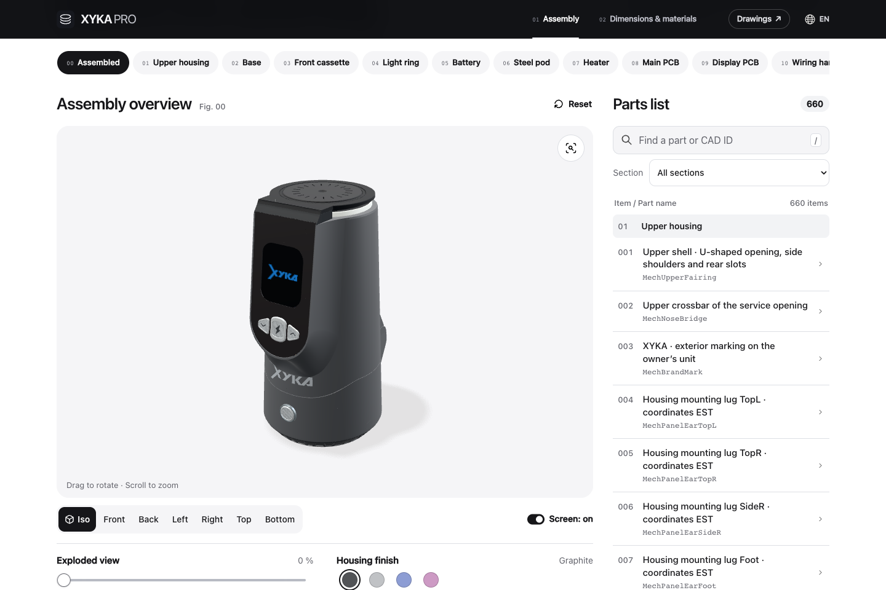
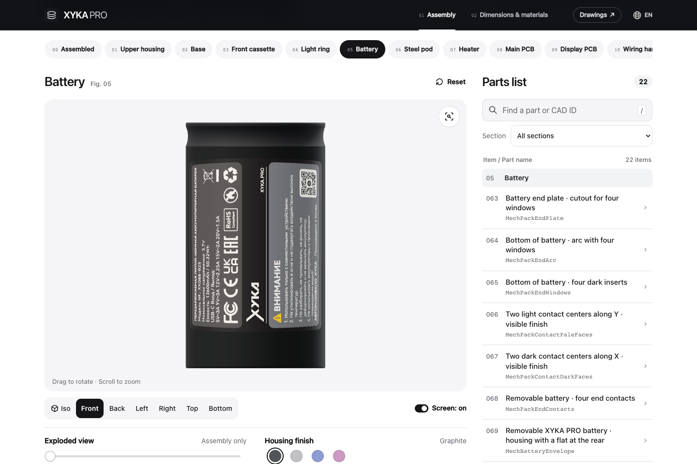

# Inside XKAH Pro · XYKA PRO

   

Lift out the battery, open the steel pod and follow the copper traces on the mainboard. This independent **3D teardown atlas** brings **660 selectable parts** and **13 teardown stages** to your browser. The [international guide](https://xkah.us/pages/xkah-pro-user-guide) and a [Chinese-language retail listing](https://www.el-badia.com/zh/chicha-electronique/6404-xkah-pro-dian-zi-jia-re-xi-tong.html) use **XKAH Pro**; the [Russian catalogue](https://xyka.pro/xyka-graphite) uses **XYKA PRO**. This model captures the XYKA-marked A4.3 unit.

**[Launch the 3D atlas](https://georgy-hook.github.io/xyka-pro-atlas/)** · [Download the offline studio](https://github.com/Georgy-hook/xyka-pro-atlas/releases/latest/download/XYKA_PRO_A43_Studio.zip)

[English](https://georgy-hook.github.io/xyka-pro-atlas/atlas/?lang=en) · [Русский](https://georgy-hook.github.io/xyka-pro-atlas/atlas/?lang=ru) · [简体中文](https://georgy-hook.github.io/xyka-pro-atlas/atlas/?lang=zh-CN)

### The assembly

Rotate the complete model, switch between four finishes, or pick a part to open its record.

### The removable battery

Inspect the pack on its own, from its printed markings to the USB-C port and end contacts.

### The mainboard

Look closer at the component side of the GYS005-S-088-A4.3. Then open the [mainboard](pcb/main/GYS005-S-088-A4.3.kicad_pcb) and [display board](pcb/display/20260305A.kicad_pcb) in KiCad.

[FreeCAD assembly](https://github.com/Georgy-hook/xyka-pro-atlas/releases/latest/download/XKAH_PRO_A43_rebuilt.FCStd) · [31-sheet drawing set (PDF, Russian)](https://github.com/Georgy-hook/xyka-pro-atlas/releases/latest/download/XKAH_PRO_A43_drawings.pdf) · [Engineering notes and sources](docs/engineering.ru.md). For offline use, unzip the studio and open `atlas/index.html`.

Original viewer and CAD tools: [MIT](LICENSE). Third-party notices: [Three.js](atlas/vendor/three-LICENSE.txt), [noUiSlider and Tabler Icons](atlas/vendor/ui-LICENSES.md), [osifont](docs/licenses/osifont.txt).
